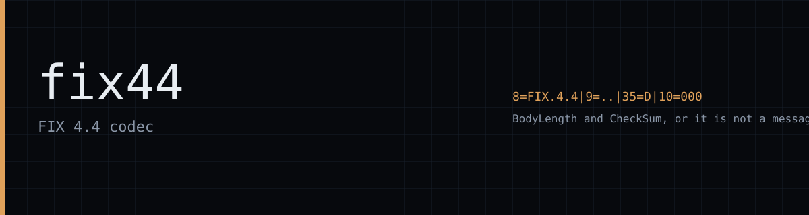

# fix44

FIX 4.4 codec. It frames one message, checks BodyLength and CheckSum, and reads a NewOrderSingle.

There is no socket, no heartbeat loop, and no sequence-number store. A session is the caller's problem. One buffer is one message, not a TCP stream.

## Build

C++17. `g++` 9 or later is enough.

```
make test
```

## Wire rules

- BeginString is `FIX.4.4`.
- BodyLength is the number of bytes after the SOH that ends `9=`, up to but not including `10=`.
- CheckSum is the sum of every byte before `10=`, modulo 256, written as three digits.
- A value is printable ASCII. SOH is the delimiter and cannot appear inside a value.
- Tag numbers have no leading zero. `8`, `9` and `10` are added by `encode` and rejected if the caller tries to pass them.

`encode` keeps the body fields in the order given. It does not reorder them to the dictionary.

## NewOrderSingle

`require_new_order` accepts `35=D` with ClOrdID, Symbol, Side (`1` buy or `2` sell), a positive OrderQty, and OrdType. Limit (`40=2`) needs a price. Market (`40=1`) must not carry one. Other order types are rejected.

Prices stay text. `150.25` is accepted. `0`, `0.00`, `01`, `.5` and `5.` are not. This is not a decimal type.

The first party group (`453`, then repeating `448`, `447`, `452`) is read. A later group is ignored. More than 1024 parties is rejected.

```cpp
std::string wire = fix44::encode({
    {35, "D"}, {49, "CLIENT"}, {56, "BROKER"}, {34, "1"},
    {52, "20261119-12:00:00.000"},
    {11, "OID-1"}, {55, "AAPL"}, {54, "1"}, {38, "100"},
    {40, "2"}, {44, "150.25"},
});
auto fields = fix44::decode(wire);
fix44::require_new_order(fields);
```

## What is not here

Resend, gap fill, raw-data fields (`95` / `96`), and repeating groups other than parties. Nothing in this repository connects to a venue.
